# 🏛️ Sistem Manajemen Sarana dan Prasarana (Asset Management)

Admin panel pengelolaan aset organisasi: katalog aset, mutasi antar-ruang, peminjaman, servis preventif & kuratif, penyusutan nilai, penghapusan/lelang, dan laporan KIR (Kartu Inventaris Ruang).

**Stack:** React + Vite + Tailwind (frontend) · Node.js + Express (backend) · PostgreSQL 16 (database) · Docker Compose (deployment)

**Desain:** Glassmorphism — panel semi-transparan, backdrop blur, edge highlight, dark/light mode.

---

## 📑 Hierarki Menu

```
SARPRAS AM · Asset Management
│
├── Dashboard                         # KPI, chart, notifikasi, aktivitas terbaru
├── DATA MASTER
│   ├── Data Aset                     # Katalog utama + QR label + dokumen lampiran
│   ├── Gudang Transit (QC)           # Verifikasi barang masuk sebelum jadi aset
│   ├── Kategori Aset                 # + umur ekonomis & akun penyusutan
│   └── Lokasi Aset                   # Gedung > lantai > ruang (hierarki)
├── KEUANGAN ASET
│   ├── Penyusutan Nilai              # Straight-line & saldo menurun, uji impairment
│   └── Sumber Dana                   # APBD / APBN / Hibah / Wakaf / BOS (atur penghapusan)
├── OPERASIONAL
│   ├── Peminjaman Aset               # Pinjam, jatuh tempo, denda
│   ├── Mutasi Antar-Ruang            # Pindah lokasi + BAST mutasi
│   ├── Servis Kuratif                # Perbaikan pasca kerusakan
│   └── Servis Preventif              # Perawatan berkala + jadwal
├── VERIFIKASI & AUDIT
│   ├── Inventarisasi Fisik           # Stock opname: scan QR vs data
│   └── Audit Trail                   # Log seluruh perubahan (siapa/apa/kapan)
├── HILIR & REKAP
│   ├── Penghapusan & Lelang          # Musnah / lelang / hibah + alur persetujuan
│   └── Laporan Aset (KIR)            # Kartu Inventaris Ruang + export PDF/Excel
└── MANAJEMEN SISTEM
    ├── Pengguna & Peran              # Admin / Petugas / Pimpinan (RBAC)
    ├── Pengaturan                    # Profil, tema, backup/restore
    └── Keluar                        # Logout
```

### Alur Bisnis Utama

```
Barang Masuk → QC Gudang Transit → Jadi Aset (beri kode & QR)
    → Ditempatkan di Ruang → Dipakai
        ├─ Dipinjam (kembali sebelum jatuh tempo)
        ├─ Dimutasi antar-ruang (BAST)
        ├─ Diservis (kuratif / preventif berkala)
        └─ Disusutkan nilainya tiap tahun
            → Diinventarisasi fisik tiap periode (stock opname)
                → Dihapus / dilelang (setelah umur ekonomis / rusak berat)
                    → Dicatat di Audit Trail (seluruh perubahan)
```

---

## 🗄️ ER-D (Mermaid)

```mermaid
erDiagram
    USERS           ||--o{ AUDIT_TRAIL : "melakukan"
    KATEGORI        ||--o{ ASET : "mengelompokkan"
    LOKASI          ||--o{ ASET : "menyimpan"
    SUMBER_DANA     ||--o{ ASET : "membiayai"
    GUDANG_TRANSIT  ||--o| ASET : "QC lolos jadi"
    ASET            ||--o{ PEMINJAMAN : "dipinjam"
    ASET            ||--o{ MUTASI : "bermutasi"
    ASET            ||--o{ SERVIS : "diservis"
    ASET            ||--o{ PENYUSUTAN : "disusutkan"
    ASET            ||--o{ PENGHAPUSAN : "diafkir"
    ASET            ||--o{ ASSET_LOG : "dicatat"
    ASET            ||--o{ DOKUMEN : "dilampiri"
    ASET            ||--o{ OPNAME_ITEM : "diopname"
    VERIFIKASI      ||--o{ OPNAME_ITEM : "memuat"
    USERS           ||--o{ VERIFIKASI : "menjalankan"

    USERS {
        int id PK
        varchar username UK
        varchar password_hash
        varchar nama
        varchar role "admin|petugas|pimpinan"
        boolean aktif
        timestamp dibuat_pada
    }
    KATEGORI {
        int id PK
        varchar nama
        text deskripsi
        int umur_ekonomis_tahun
        decimal persen_penyusutan
        varchar akun_penyusutan "kode akun COA"
    }
    LOKASI {
        int id PK
        varchar nama "Ruang 301"
        varchar gedung
        varchar lantai
        varchar penanggung_jawab
        int parent_id FK "hierarki gedung>lantai>ruang"
    }
    SUMBER_DANA {
        int id PK
        varchar nama "APBD|APBN|Hibah|Wakaf|BOS"
        varchar kode
        int tahun_anggaran
        text ketentuan_penghapusan
    }
    GUDANG_TRANSIT {
        int id PK
        varchar nama_barang
        varchar pengirim
        date tgl_terima
        varchar qc_status "Menunggu|Lolos|Ditolak"
        text catatan_qc
        varchar aset_kode FK "diisi saat QC lolos"
    }
    ASET {
        varchar kode PK "AM-2024-0001"
        varchar nama
        int kategori_id FK
        int lokasi_id FK
        int sumber_dana_id FK
        date tanggal_perolehan
        decimal nilai_perolehan
        varchar kondisi "Baik|Rusak Ringan|Rusak Berat"
        varchar status "Aktif|Dipinjam|Servis|Mutasi|Dihapus"
        varchar merk
        varchar tipe
        varchar no_seri
        varchar qr_token UK
        varchar foto_url
        boolean ada_di_fisik "hasil opname terakhir"
    }
    PEMINJAMAN {
        int id PK
        varchar aset_kode FK
        varchar peminjam
        varchar unit
        date tgl_pinjam
        date tgl_kembali_rencana
        date tgl_kembali_aktual
        varchar status "Dipinjam|Dikembalikan|Terlambat"
        decimal denda
        text keperluan
    }
    MUTASI {
        int id PK
        varchar aset_kode FK
        int lokasi_asal_id FK
        int lokasi_tujuan_id FK
        date tanggal
        text alasan
        varchar no_bast
        int disetujui_oleh FK
    }
    SERVIS {
        int id PK
        varchar aset_kode FK
        varchar jenis "Kuratif|Preventif"
        date tanggal
        date jadwal_berikutnya
        text masalah
        decimal biaya
        varchar vendor
        varchar status "Antri|Proses|Selesai"
    }
    PENYUSUTAN {
        int id PK
        varchar aset_kode FK
        int tahun
        varchar metode "Garis Lurus|Saldo Menurun"
        decimal nilai_awal
        decimal beban_tahunan
        decimal akumulasi
        decimal nilai_buku
        decimal nilai_wajar "untuk uji impairment"
    }
    PENGHAPUSAN {
        int id PK
        varchar aset_kode FK
        varchar metode "Musnah|Lelang|Hibah"
        date tanggal
        decimal nilai_buku
        decimal nilai_lelang
        text alasan
        varchar status "Usulan|Disetujui|Ditolak"
        int disetujui_oleh FK
    }
    DOKUMEN {
        int id PK
        varchar aset_kode FK
        varchar jenis "Faktur|BAST|Kwitansi|Garansi"
        varchar nama_file
        varchar url
        date unggah_pada
    }
    VERIFIKASI {
        int id PK
        varchar kode "OPN-2024-Q1"
        date tanggal_mulai
        date tanggal_selesai
        varchar status "Berjalan|Selesai"
        int dijalankan_oleh FK
    }
    OPNAME_ITEM {
        int id PK
        int verifikasi_id FK
        varchar aset_kode FK
        boolean ditemukan
        varchar kondisi_fisik
        int lokasi_temuan_id FK
        text catatan
    }
    AUDIT_TRAIL {
        bigint id PK
        int user_id FK
        varchar entitas "aset|peminjaman|..."
        varchar entitas_id
        varchar aksi "CREATE|UPDATE|DELETE|LOGIN"
        jsonb sebelum
        jsonb sesudah
        varchar ip
        timestamp waktu
    }
    ASSET_LOG {
        int id PK
        varchar aset_kode FK
        varchar aksi
        varchar aktor
        timestamp waktu
        jsonb detail
    }
```



---

## 🎨 Design System — Glassmorphism Tokens

| Token | Nilai | Keterangan |
|---|---|---|
| `--glass-blur` | 22px | backdrop-filter blur |
| `--glass-opacity` | 0.55 | opasitas permukaan panel |
| `--glass-saturation` | 1.4 | saturasi backdrop |
| `--glass-edge` | rgba(255,255,255,.14) | inset highlight |
| `--radius-panel` | 20px | sudut kartu utama |
| `--radius-control` | 10px | sudut tombol/input |
| Accent | #2563eb (light) / #60a5fa (dark) | aksi utama |
| Surface | #f8fafc (light) / #0b1220 (dark) | latar |

**Tipografi:** Inter / system-ui. Judul 600-700, body 400.

---

## 🗂️ Struktur Folder

```
sarpras-asset-management/
├── docs/
│   └── PERANCANGAN.md        # File ini (Milestone 1)
├── backend/                  # Express API
│   ├── src/
│   │   ├── index.js          # Entry point
│   │   ├── db.js             # Pool Postgres
│   │   ├── middleware/auth.js# JWT guard
│   │   ├── routes/           # 9 route modul
│   │   └── schema.sql        # DDL + seed
│   ├── package.json
│   └── .env.example
├── frontend/
│   ├── index.html            # Login (sesuai brief UTS)
│   ├── layout.html           # Template dasar
│   ├── assets/{css,js,img}/
│   ├── pages/
│   │   ├── dashboard.html
│   │   ├── data-aset.html
│   │   ├── gudang-transit.html
│   │   ├── kategori-aset.html
│   │   ├── lokasi-aset.html
│   │   ├── penyusutan.html
│   │   ├── peminjaman.html
│   │   ├── mutasi.html
│   │   ├── servis-kuratif.html
│   │   ├── servis-preventif.html
│   │   ├── penghapusan.html
│   │   ├── laporan-kir.html
│   │   └── pengaturan.html
│   └── package.json          # Vite build
├── docker-compose.yml        # Postgres 16 + backend + frontend
└── README.md
```

---

## 🔗 Navigasi Proyek

- **Database:** PostgreSQL 16 (Docker) — 10 tabel inti + tabel users
- **Backend:** Express REST API — JWT auth, bcrypt password hash
- **Frontend:** Multi-page HTML + Tailwind CDN + Chart.js — glassmorphism
- **Deployment:** Docker Compose — 3 service (db, api, web)
